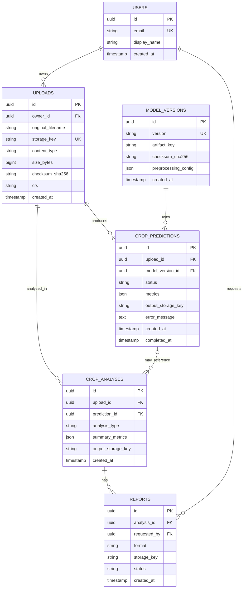
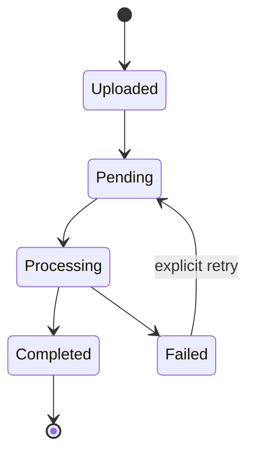

# LLM Crop Analysis — Database Design

**Document status:** Proposed logical database design  
**Database:** PostgreSQL with PostGIS extension  
**ORM:** SQLAlchemy  
**Important:** The repository currently identifies a `CropPrediction` ORM model, but its exact columns and constraints have not been inspected here. The entities below are a proposed target design. Reconcile them with the actual `models.py`, migrations, and live database before applying schema changes.

## 1. Database design objectives

- Persist metadata and relationships, not large raster/image binaries by default.
- Keep uploaded files and generated outputs in controlled file/object storage.
- Track prediction and analysis lifecycle and failure status.
- Support spatial queries through PostGIS when geographic footprints are available.
- Preserve existing records and avoid destructive migrations.
- Use constraints, indexes, transactions, and foreign keys to protect data integrity.

## 2. Proposed logical entities

| Entity | Purpose | Core relationships |
|---|---|---|
| `users` (optional, if authentication exists/is required) | Application identities | One user owns many uploads/analyses |
| `datasets` (optional registry) | Dataset/product metadata | One dataset may be referenced by many uploads |
| `uploads` | Original uploaded image metadata and storage key | One upload may have many predictions/analyses |
| `model_versions` | Approved model artifact and preprocessing metadata | One model version may produce many predictions |
| `crop_predictions` | Prediction request, status, metrics, and output references | Belongs to upload and model version |
| `crop_analyses` | NDVI/health analysis metadata and summary | Belongs to upload and optionally prediction |
| `reports` | Generated report metadata and storage key | Belongs to an analysis/prediction |
| `audit_events` (recommended) | Important user/system actions | References actor and affected resource |

If the existing application is single-user and has no authentication, do not add a `users` table merely for appearance. Add it only with a defined identity/ownership requirement.

## 3. Entity relationship diagram



The ERD is conceptual. In particular, the `users` relationship is conditional, and the final schema must reflect actual authentication and ownership requirements.

## 4. Proposed table definitions

Types below are PostgreSQL-oriented. Use SQLAlchemy UUID handling consistently with the project's PostgreSQL driver and migration setup.

### 4.1 `uploads`

| Column | Type | Rules | Description |
|---|---|---|---|
| `id` | UUID | PK | Server-generated upload identifier |
| `owner_id` | UUID | nullable FK if users are implemented | Owner |
| `original_filename` | VARCHAR(255) | NOT NULL | Display-only original name |
| `storage_key` | TEXT | UNIQUE, NOT NULL | Internal storage identifier |
| `content_type` | VARCHAR(100) | NOT NULL | Validated media type |
| `size_bytes` | BIGINT | NOT NULL, CHECK >= 0 | File size |
| `checksum_sha256` | CHAR(64) | optional | Integrity/deduplication aid |
| `crs` | VARCHAR(32) | optional | Coordinate reference system |
| `metadata` | JSONB | optional | Sensor, acquisition date, band metadata |
| `created_at` | TIMESTAMPTZ | NOT NULL | UTC creation time |

### 4.2 `model_versions`

| Column | Type | Rules | Description |
|---|---|---|---|
| `id` | UUID | PK | Model version identifier |
| `version` | VARCHAR(100) | UNIQUE, NOT NULL | Human-readable version |
| `architecture` | VARCHAR(100) | NOT NULL | For example, U-Net |
| `artifact_key` | TEXT | NOT NULL | Checkpoint storage key |
| `checksum_sha256` | CHAR(64) | optional | Artifact integrity |
| `preprocessing_config` | JSONB | NOT NULL | Band order, normalization, input size, class mapping |
| `metrics` | JSONB | optional | Evaluation metrics |
| `is_active` | BOOLEAN | NOT NULL DEFAULT FALSE | Whether selected for new inference |
| `created_at` | TIMESTAMPTZ | NOT NULL | Registration time |

### 4.3 `crop_predictions`

This is the proposed evolution of the existing `CropPrediction` concept. Do not replace the current table until its actual schema and data are inspected.

| Column | Type | Rules | Description |
|---|---|---|---|
| `id` | UUID | PK | Prediction identifier |
| `upload_id` | UUID | FK, NOT NULL | Input image |
| `model_version_id` | UUID | FK, nullable during transition | Model used |
| `status` | VARCHAR(20) | NOT NULL | `PENDING`, `PROCESSING`, `COMPLETED`, `FAILED` |
| `class_summary` | JSONB | optional | Pixel/area counts by class |
| `metrics` | JSONB | optional | Prediction-level metrics |
| `output_storage_key` | TEXT | optional | Segmentation mask/result |
| `error_message` | TEXT | optional | Sanitized failure description |
| `created_at` | TIMESTAMPTZ | NOT NULL | Request time |
| `completed_at` | TIMESTAMPTZ | optional | Completion time |

### 4.4 `crop_analyses`

| Column | Type | Rules | Description |
|---|---|---|---|
| `id` | UUID | PK | Analysis identifier |
| `upload_id` | UUID | FK, NOT NULL | Source image |
| `prediction_id` | UUID | FK, nullable | Related segmentation, if applicable |
| `analysis_type` | VARCHAR(40) | NOT NULL | For example `NDVI` or `CROP_HEALTH` |
| `summary_metrics` | JSONB | optional | Mean/min/max NDVI, valid pixel count, health summary |
| `output_storage_key` | TEXT | optional | Raster/map/chart output |
| `created_at` | TIMESTAMPTZ | NOT NULL | Analysis time |

### 4.5 `reports`

| Column | Type | Rules | Description |
|---|---|---|---|
| `id` | UUID | PK | Report identifier |
| `analysis_id` | UUID | FK, NOT NULL | Source analysis |
| `requested_by` | UUID | nullable FK if users exist | Requesting user |
| `format` | VARCHAR(10) | NOT NULL | `PDF`, `CSV`, or `JSON` |
| `storage_key` | TEXT | NOT NULL | Generated file reference |
| `status` | VARCHAR(20) | NOT NULL | `PENDING`, `COMPLETED`, `FAILED` |
| `created_at` | TIMESTAMPTZ | NOT NULL | Request time |

## 5. Geospatial data strategy

Use PostGIS only for spatial data that the application needs to query.

Possible columns, if supported by the input data and product requirements:

- `footprint GEOMETRY(POLYGON, <SRID>)` for image/area footprints.
- `centroid GEOMETRY(POINT, <SRID>)` for a representative location.
- Raster outputs may remain in GeoTIFF/object storage; store their storage keys and relevant metadata in PostgreSQL.

Do not choose an SRID without confirming the source imagery CRS and reprojection policy. Use a GiST index for spatial geometry columns:

```sql
CREATE INDEX IF NOT EXISTS ix_uploads_footprint_gist
ON uploads USING GIST (footprint);
```

Only run this after the `footprint` column has been added through a reviewed migration.

## 6. Indexes and integrity rules

Recommended indexes, subject to actual query patterns:

```sql
CREATE INDEX IF NOT EXISTS ix_predictions_upload_id
ON crop_predictions (upload_id);

CREATE INDEX IF NOT EXISTS ix_predictions_status_created
ON crop_predictions (status, created_at DESC);

CREATE INDEX IF NOT EXISTS ix_analyses_upload_id_created
ON crop_analyses (upload_id, created_at DESC);

CREATE INDEX IF NOT EXISTS ix_reports_analysis_id
ON reports (analysis_id);
```

Recommended integrity rules:

- Primary keys on every entity.
- Foreign keys with deliberate `ON DELETE` behavior.
- Unique storage keys and model version names.
- `CHECK (size_bytes >= 0)` for uploads.
- Controlled status and format values, preferably validated in both application and database layers.
- UTC timestamps (`TIMESTAMPTZ`).
- Use transactions when creating related upload/prediction/analysis metadata.
- Avoid cascading deletion of files or records unless retention policy explicitly requires it.

## 7. Data lifecycle



The lifecycle is proposed. If the current implementation performs prediction synchronously, preserve its current response behavior first; introduce background jobs only as a separately tested enhancement.

## 8. API-to-database mapping

| API operation (proposed) | Reads | Writes |
|---|---|---|
| Create upload/prediction | Model version configuration | `uploads`, `crop_predictions` |
| Get prediction | `crop_predictions`, `uploads`, `model_versions` | None |
| Create NDVI analysis | `uploads`, optionally `crop_predictions` | `crop_analyses` |
| Get analysis | `crop_analyses`, `uploads` | None |
| Create report | `crop_analyses` | `reports` |
| Dashboard statistics | Prediction and analysis aggregates | None |

The API must not expose SQLAlchemy models directly. Return Pydantic response schemas and authorized storage/download references.

## 9. Migration and backward-compatibility plan

1. Inspect the actual SQLAlchemy models, database constraints, indexes, and migration history.
2. Take a verified database backup and test restore before schema changes.
3. Record the current schema and row counts.
4. Create migrations using Alembic (if not already used).
5. Prefer additive changes: new nullable columns/tables and backfills before enforcing constraints.
6. Backfill and validate data before making new columns non-null.
7. Keep existing table names and API behavior during the first migration where practical.
8. Test migrations against both an empty database and a copy of existing data.
9. Deploy application code compatible with both old and new schema during transition.
10. Remove deprecated fields only in a later release after confirming no callers depend on them.

Never drop or rename existing tables/columns based only on this proposed document.

## 10. Backup, retention, and privacy

- Back up PostgreSQL regularly and test restoration.
- Back up file/object storage independently; a database backup alone does not restore uploaded imagery.
- Define retention and deletion policies for uploaded images, predictions, and reports.
- Restrict access to records and files by user/tenant if multi-user access is enabled.
- Do not store secrets in the database as plain text.
- Avoid storing large raster files as JSONB or byte arrays unless there is a specific, reviewed reason.

## 11. Items to verify before implementation

- Exact current `CropPrediction` columns, types, indexes, and constraints.
- Whether any additional tables already exist.
- Whether PostGIS is enabled and which SRIDs are in use.
- Current frontend filters and dashboard query patterns.
- Whether user authentication and multi-tenancy are implemented.
- Existing prediction status and file-path conventions.
- Existing migrations and production data volume.
- Exact NDVI metadata and model-version information currently available.

**Acceptance criterion:** the final physical schema must be derived from the inspected code and database, and all existing records and API consumers must continue to work.
