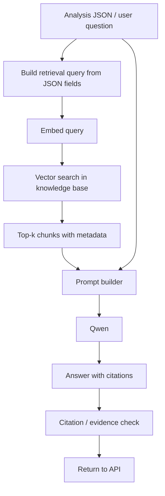

# Qwen and RAG Integration Plan

**Owner:** Dheeraj (Member 4)
**Document status:** Proposed design. No part of this plan is implemented yet.
**Related:** [`llm_rag/README.md`](../llm_rag/README.md), [`system_architecture.md`](system_architecture.md), [`database_design.md`](database_design.md)

## 1. Background

The project abstract defines an LLM-based analytical layer above the U-Net and machine-learning models. The repository README mentions an existing *LLM Insights* page and an insight endpoint with a Mistral-7B-ready design. This plan proposes **Qwen** for that layer, extended with **Retrieval-Augmented Generation (RAG)** so that explanations are grounded in evidence instead of the model's memory.

## 2. Role of Qwen

| Qwen does | Qwen does NOT do |
|---|---|
| Interpret structured model outputs | Process raw Sentinel-2A pixels |
| Explain crop pattern, crop health and water conditions | Perform segmentation or classification |
| Summarise results for farmers, planners and researchers | Compute NDVI/NDWI/EVI or metrics (done by code) |
| Cite retrieved evidence | Produce unsupported numbers or yield values |

## 3. Input to Qwen: structured analysis JSON (proposed draft)

Produced by the backend after segmentation and index computation. Field names are a proposal to be reconciled with the final U-Net output format and database design.

```json
{
  "analysis_id": "string",
  "image": {
    "source": "Sentinel-2A",
    "acquisition_date": "YYYY-MM-DD or null",
    "region": "string or null",
    "bands_used": ["B2", "B3", "B4", "B8", "B11"]
  },
  "segmentation": {
    "model": "U-Net",
    "model_version": "string",
    "classes": [
      { "name": "string", "area_ha": 0.0, "percent": 0.0 }
    ]
  },
  "vegetation_indices": {
    "NDVI": { "mean": 0.0, "min": 0.0, "max": 0.0 },
    "NDWI": { "mean": 0.0 },
    "EVI":  { "mean": 0.0 }
  },
  "model_metrics": {
    "accuracy": null, "f1": null, "iou": null, "dice": null
  },
  "data_quality": {
    "cloud_cover_percent": null,
    "notes": "string"
  },
  "yield_reference_available": false
}
```

`null` means the value is not available. Qwen must treat `null` as missing evidence, never fill it in.

## 4. Knowledge sources for RAG (planned)

| Source | Use | Notes |
|---|---|---|
| Crop and agronomy guidelines (government / university extension documents) | Crop growth stages, water and health indicators | Only openly usable documents; record source and date |
| Vegetation-index references (NDVI, NDWI, EVI definitions and interpretation ranges) | Explain what index values indicate | Include index formulas and limitations |
| Project reference papers already in the repository (`Base_Paper.pdf`, `Reference_Paper_01` to `05`) | Methodology and context for explanations | Cited by paper, not copied verbatim |
| Project's own model and validation reports | Explain reliability of results | Added once real results exist |
| Class definitions for the segmentation labels | Consistent terminology | From dataset documentation |

Each document carries metadata: `source_id`, `title`, `type`, `year`, `page/section`. Metadata is returned with every retrieved chunk so it can be cited.

## 5. Embeddings, chunking and vector store (planned)

- **Embedding model:** a multilingual sentence-embedding model (candidate: `BAAI/bge-m3`), chosen so Telugu/English queries can both be supported later. Final choice after a small retrieval test on our own documents.
- **Chunking:** section-aware splitting with moderate chunk size and small overlap; tables and index-range lists kept intact inside one chunk. Exact sizes to be tuned during testing.
- **Vector store:** ChromaDB, local and persistent, for the prototype. pgvector (PostgreSQL is already in the architecture) is a possible later option; decision deferred.
- **Retrieval:** top-k similarity search, optionally filtered by document type; k and any re-ranking decided by evaluation.

## 6. Retrieval and generation flow



1. **Query:** built from the JSON (for example dominant classes, NDVI level, water index) plus the user's question if any.
2. **Retrieve:** fetch relevant chunks with metadata.
3. **Prompt construction:** system rules + analysis JSON + numbered evidence chunks + task.
4. **Qwen response:** structured answer (summary, crop pattern, crop health, yield-related notes, limitations).
5. **Check:** verify that every cited ID exists and that numbers in the answer match the JSON.

## 7. Evidence-grounded responses

Rules placed in the system prompt and enforced by a post-check:

- Each statement cites `[JSON:field]` or `[S#]` (retrieved source number).
- If needed evidence is absent, respond: *"Insufficient data: <what is missing>."*
- Numbers (area, NDVI, metrics) are copied from the JSON only.
- Yield: if `yield_reference_available` is false, no yield figure is given, only qualitative yield-related patterns with a stated limitation.
- Low-quality inputs (for example high cloud cover) must be mentioned as a caveat.
- Output includes a list of sources used.

## 8. Integration points

| Layer | Integration | Status |
|---|---|---|
| Backend (FastAPI) | Insight route receives an `analysis_id`, loads the JSON, runs retrieval and Qwen, returns answer + sources | Planned |
| Database | Store generated insight, model/prompt version and source references with the analysis record | Planned (to align with `database_design.md`) |
| React dashboard | LLM Insights page shows answer, cited sources and an "insufficient data" state | Planned (to align with frontend design) |
| Deployment | Qwen served locally on GPU; model size depends on available GPU memory | Planned |

## 9. Evaluation plan for the LLM layer (planned)

| Aspect | Method |
|---|---|
| Faithfulness | Automatic check that numbers and claims match the JSON; manual review of a sample for unsupported statements |
| Relevance | Review of whether retrieved chunks are useful for the case |
| Citation correctness | Cited IDs exist and support the claim |
| Abstention | Test cases with missing fields; the model must answer "Insufficient data" |
| Expert review | Agricultural-domain reviewer (via guide/department) rates usefulness and correctness |

No scores exist yet. Results will be reported only after real experiments.

## 10. Risks and limitations

- Exact yield estimation depends on suitable ground-truth and yield-reference data, as stated in the abstract.
- The LLM can only be as correct as the segmentation and index outputs it receives.
- Retrieval quality depends on the knowledge base; poor documents give poor grounding.
- Cloud contamination, mixed pixels and similar spectral signatures affect the upstream models.
- Larger Qwen variants may not fit available GPU memory; smaller or quantized variants may reduce quality.
- Knowledge-base documents must have usable licences.

## 11. Status

| Item | Status |
|---|---|
| Qwen role and boundaries | Completed (design) |
| Input JSON schema | Completed (draft) |
| RAG design and evidence rules | Completed (design) |
| Knowledge-base collection | Planned |
| Embedding and vector index | Planned |
| Qwen inference setup and model selection | Planned |
| Prompt templates | Planned |
| Backend and dashboard integration | Planned |
| Evaluation | Planned |
