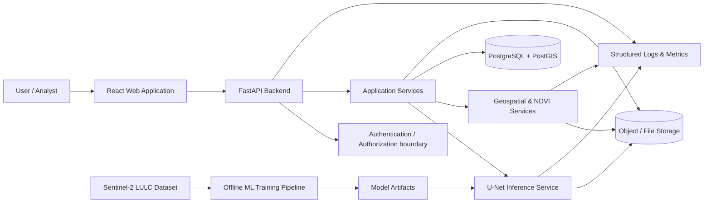
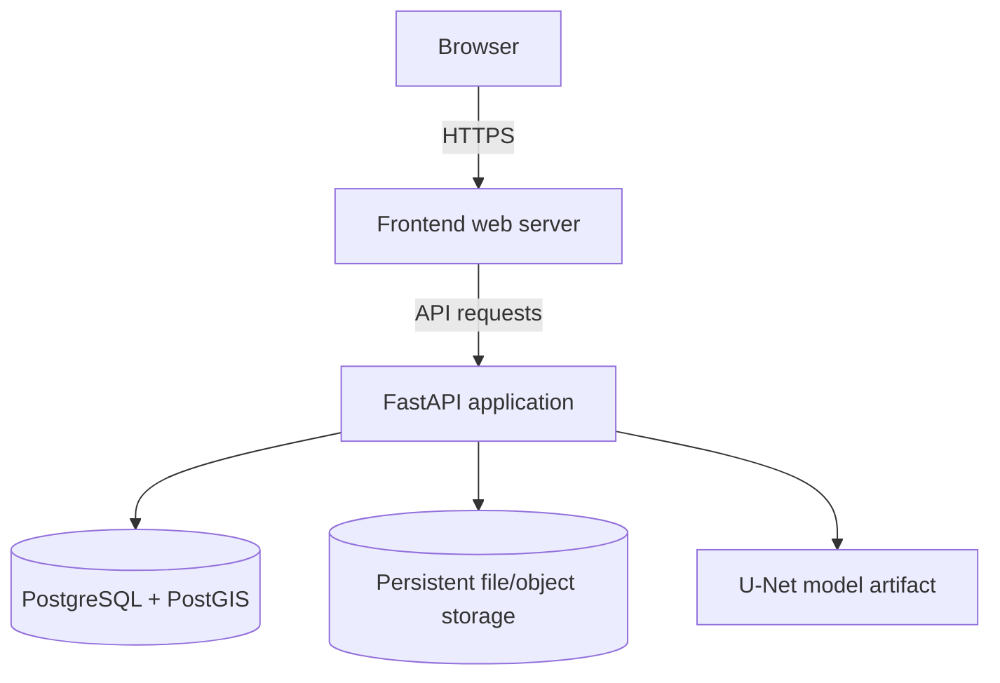

# LLM Crop Analysis — System Architecture

**Document status:** Proposed production architecture  
**Scope:** Full-stack crop analysis application  
**Existing core stack:** React, Tailwind CSS, FastAPI, PyTorch/U-Net, PostgreSQL, PostGIS, SQLAlchemy  
**Important:** This document describes the target architecture. Existing routes, schemas, and behaviors must be inventoried from the codebase before refactoring. Do not treat proposed interfaces as already implemented.

## 1. Purpose and goals

The system accepts supported satellite imagery, runs crop/land-cover segmentation using a trained U-Net model, derives crop-health indicators such as NDVI, stores analysis metadata and geospatial information, and presents results through a web dashboard.

The architecture aims to:

- Preserve current user-visible features and API behavior during restructuring.
- Separate presentation, API orchestration, business logic, ML inference, persistence, and file storage.
- Keep model training and experimentation separate from the online prediction service.
- Make data paths, configuration, and error handling explicit.
- Support repeatable local development and containerized deployment.
- Make it possible to test components independently and run end-to-end tests.

## 2. System context



### Main actors

- **Analyst:** uploads imagery, starts analysis, views maps/metrics, and exports reports.
- **Administrator/operator:** manages deployment configuration, model versions, database migrations, and operational monitoring.
- **ML developer:** prepares datasets, trains/evaluates U-Net, and promotes approved model artifacts.

## 3. Proposed repository boundaries

```text
crop-llm-platform/
├── backend/
│   ├── app/
│   │   ├── main.py
│   │   ├── api/
│   │   │   ├── routes/
│   │   │   │   ├── health.py
│   │   │   │   ├── predictions.py
│   │   │   │   ├── analyses.py
│   │   │   │   ├── analytics.py
│   │   │   │   └── reports.py
│   │   │   └── dependencies.py
│   │   ├── core/
│   │   │   ├── config.py
│   │   │   ├── logging.py
│   │   │   └── exceptions.py
│   │   ├── db/
│   │   │   ├── session.py
│   │   │   ├── models/
│   │   │   └── repositories/
│   │   ├── schemas/
│   │   ├── services/
│   │   │   ├── prediction_service.py
│   │   │   ├── crop_health_service.py
│   │   │   └── report_service.py
│   │   └── integrations/
│   │       ├── model_loader.py
│   │       └── storage.py
│   ├── migrations/
│   ├── tests/
│   ├── requirements.txt
│   └── Dockerfile
├── ml/
│   ├── models/unet.py
│   ├── data/dataset.py
│   ├── training/train.py
│   ├── evaluation/evaluate.py
│   ├── inference/predict.py
│   └── tests/
├── frontend/
│   ├── src/
│   │   ├── components/
│   │   ├── pages/
│   │   ├── services/
│   │   ├── hooks/
│   │   ├── types/
│   │   └── utils/
│   └── Dockerfile
├── analytics/
├── storage/                 # Runtime data; normally not committed
│   ├── uploads/
│   ├── predictions/
│   └── reports/
├── datasets/                # External/local datasets; not committed
├── model-artifacts/         # Versioned or mounted model files
├── docs/
├── docker-compose.yml
├── .env.example
├── .gitignore
└── README.md
```

This is a proposed target layout, not an instruction to move files blindly. First map each existing module, import, route, model path, and frontend API call to its destination. Keep compatibility wrappers or temporary aliases if needed during migration.

## 4. Component responsibilities

| Component | Responsibility | Must not own |
|---|---|---|
| React frontend | User interaction, upload UI, maps, charts, reports display | Database credentials, model execution |
| FastAPI routes | HTTP validation, status codes, request/response serialization | Heavy ML or SQL business logic |
| Application services | Orchestrate prediction, analysis, and report workflows | UI presentation |
| Repositories / SQLAlchemy | Persist and retrieve domain records | Model inference |
| U-Net inference service | Load approved checkpoint and run prediction | HTTP routing or user-interface logic |
| Geospatial/NDVI service | Band validation, index calculations, spatial operations | React rendering |
| Storage adapter | Save and retrieve uploaded/generated files | Business decisions |
| Offline ML pipeline | Dataset preparation, training, evaluation, checkpoint creation | Serving user requests |
| Configuration | Read validated environment settings | Hard-coded secrets |

## 5. Main data flows

### 5.1 Image upload and prediction

1. User selects a supported satellite image in the React upload component.
2. Frontend sends a multipart request to the prediction API.
3. API validates file type, size, and required metadata.
4. Storage adapter writes the original file using a generated identifier; it does not trust the client filename as a storage path.
5. Prediction service loads the approved model artifact and preprocesses the image using the same band order, scaling, and normalization used during training.
6. U-Net produces a segmentation output.
7. The output is stored, and prediction metadata is persisted in PostgreSQL.
8. API returns a prediction identifier, status, and result references.
9. Frontend retrieves and displays the segmentation result and related metadata.

### 5.2 Crop health / NDVI analysis

1. User selects an image or an existing prediction/analysis.
2. Backend verifies that the required spectral bands are present and correctly mapped.
3. NDVI is computed using the appropriate red and near-infrared bands:

   `NDVI = (NIR - Red) / (NIR + Red)`

4. Handle zero/near-zero denominators, invalid pixels, nodata, and output range explicitly.
5. Persist summary metrics and output-file references; store large rasters/files in storage rather than database blobs by default.
6. Frontend displays the map, statistics, and health report.

**Band mapping must be dataset/product-specific.** Do not assume array channel positions without validating the Sentinel-2 product and the project's preprocessing pipeline.

### 5.3 Report export

1. Frontend requests a report for an authorized analysis.
2. Report service reads persisted metrics and result references.
3. It generates the requested export format.
4. The report is stored and a download reference is returned.
5. The API checks ownership/authorization before allowing download.

### 5.4 Offline training and model promotion

1. Dataset loader reads train/validation/test splits.
2. Training script trains the U-Net model and records configuration and metrics.
3. Evaluation script produces evaluation metrics and visualizations.
4. A selected checkpoint is promoted to the model-artifact location with a version and checksum.
5. The inference service is configured to load that approved artifact.
6. Training data, checkpoints, and logs are not mixed with request-time application data.

## 6. API boundaries (proposed)

The exact existing endpoints must be captured from FastAPI route declarations and frontend service calls before implementation. The following are suggested resource boundaries, not claims about current routes.

| Resource | Example method/path | Purpose |
|---|---|---|
| Health | `GET /api/v1/health` | Liveness/readiness information |
| Predictions | `POST /api/v1/predictions` | Upload imagery and create prediction |
| Predictions | `GET /api/v1/predictions/{prediction_id}` | Retrieve prediction status and metadata |
| Predictions | `GET /api/v1/predictions/{prediction_id}/result` | Retrieve result metadata or authorized file |
| Analyses | `POST /api/v1/analyses/ndvi` | Request NDVI analysis |
| Analyses | `GET /api/v1/analyses/{analysis_id}` | Retrieve analysis and metrics |
| Reports | `POST /api/v1/reports` | Generate report for an analysis |
| Reports | `GET /api/v1/reports/{report_id}` | Retrieve report metadata/download reference |
| Statistics | `GET /api/v1/statistics` | Dashboard summary, with documented filters |

### API contract rules

- Keep current routes and response shapes stable during the first refactoring phase.
- Introduce `/api/v1` only through a compatibility plan; do not silently rename routes.
- Use Pydantic request/response schemas and consistent error responses.
- Return appropriate HTTP status codes; use `202 Accepted` only for genuinely asynchronous work.
- Set upload limits and validate MIME type, extension, file signature, dimensions, band count, and size.
- Use pagination for potentially large result collections.
- Do not expose absolute server filesystem paths to the frontend.
- Document endpoints with FastAPI OpenAPI and add contract tests.

## 7. Data and storage boundaries

- PostgreSQL stores structured metadata, ownership, status, metrics, and references.
- PostGIS stores spatial geometry or geography when spatial queries are required.
- Uploaded rasters, masks, charts, and generated reports belong in filesystem/object storage.
- Database records should store storage keys/relative identifiers, not machine-specific absolute paths.
- Local development may use a mounted `storage/` directory. Production can use an object-storage adapter without changing service contracts.
- Datasets and model checkpoints should be managed separately from application source code.

## 8. Reliability, security, and operations

### Reliability

- Use database transactions for related metadata updates.
- Make prediction creation idempotent where retries could create duplicate work.
- Track analysis states such as `PENDING`, `PROCESSING`, `COMPLETED`, and `FAILED` if processing is asynchronous.
- Record failure reasons safely without leaking secrets or internal paths.
- Validate model artifact existence, checksum, expected architecture, and preprocessing metadata at startup.
- Add timeouts and resource limits for uploads and expensive operations.

### Security

- Keep `.env` out of version control; commit only `.env.example` with placeholders.
- Never return database credentials, stack traces, or internal paths to clients.
- Add authentication and role/ownership checks before exposing multi-user data.
- Restrict CORS to configured frontend origins.
- Validate and sanitize filenames; generate server-side storage names.
- Apply upload size/type limits and protect download endpoints.
- Use TLS and managed secrets in production.

### Observability

- Use Python's standard `logging` with structured fields.
- Include request ID, prediction ID, duration, and status in logs where available.
- Keep logs on stdout/stderr in containers; use the platform log collector.
- Add health/readiness checks and monitor API latency, prediction failures, and resource usage.

## 9. Deployment view



For local development, Docker Compose may run frontend, backend, and PostgreSQL/PostGIS. Production deployment should use managed database/storage where appropriate, HTTPS termination, secrets management, backups, and health checks.

**Database image note:** use a PostgreSQL image that includes the required PostGIS extension/version. Do not assume the plain PostgreSQL image provides PostGIS.

## 10. Testing and release gates

Before declaring the refactor complete:

1. Capture baseline behavior: existing routes, frontend API calls, sample inputs, outputs, and database schema.
2. Add unit tests for preprocessing, NDVI, model output handling, and validation.
3. Add repository/service tests using a test database.
4. Add API integration tests for upload, prediction, retrieval, NDVI, and report flows.
5. Add frontend tests for upload, loading/error states, maps, charts, and exports.
6. Add end-to-end smoke tests using a small known sample image.
7. Verify model checkpoint compatibility and compare outputs/metrics against the baseline.
8. Run migrations against a clean database and a copy of the existing schema.
9. Build and start the Docker Compose environment; verify health checks and persistent volumes.
10. Keep a rollback path and do not delete old files/artifacts until the new flow passes acceptance tests.

## 11. Architecture decisions to confirm from the codebase

- Current endpoint names, methods, payloads, and response formats.
- Current `CropPrediction` columns and any other existing tables.
- Whether prediction is synchronous or background processing.
- Exact Sentinel-2 band order, scaling, CRS, resolution, and nodata handling.
- Current model input shape, class mapping, and preprocessing.
- Whether PostGIS geometry is currently persisted or only planned.
- Current upload/output paths and frontend download behavior.
- Authentication and tenant/ownership requirements.

These are codebase discovery items. Confirm them before changing implementation.
