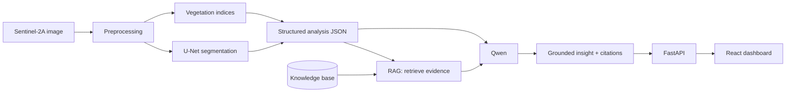

# LLM + RAG Layer (Qwen)

**Owner:** Dheeraj (Member 4) | **Meeting:** First guide meeting, 7 November 2026
**Detailed design:** [`docs/qwen_integration_plan.md`](../docs/qwen_integration_plan.md)

> **Status: Planning stage.** No Qwen or RAG code exists in this repository yet. Everything below describes the intended design and is labelled accordingly.

## 1. Purpose

This module is the **LLM-based analytical layer** described in the project abstract. It sits *above* the image-processing and classification models.

- Qwen **does not** read satellite pixels.
- Qwen **only** interprets *structured outputs*: segmentation results, crop-area information, vegetation-index values (NDVI, NDWI, EVI) and model metrics.
- It turns these into readable crop-pattern, crop-health and yield-related insights, grounded in retrieved evidence.

## 2. Position in the system



## 3. Planned components

| Component | Planned choice | Status |
|---|---|---|
| LLM | Qwen instruction-tuned model (exact size/version to be fixed after GPU memory test) | Planned |
| Embeddings | Multilingual sentence-embedding model (candidate: `BAAI/bge-m3`) | Planned |
| Vector store | ChromaDB (local, persistent) for prototype; pgvector considered later | Planned |
| Knowledge base | Agronomy/crop guidelines, index-interpretation references, project model reports | Planned |
| Prompt builder | Template combining analysis JSON + retrieved chunks + rules | Planned |
| Backend endpoint | Replace/extend the insight endpoint in FastAPI | Planned |
| Dashboard page | LLM Insights page showing answer + sources | Planned |
| Evaluation | Faithfulness, relevance, expert review | Planned |

## 4. Intended folder layout (to be created only when code is written)

```text
llm_rag/
├── README.md            # this file
├── knowledge_base/      # source documents + metadata (planned)
├── ingestion/           # parse, chunk, embed, index (planned)
├── retrieval/           # retriever + filters (planned)
├── prompts/             # prompt templates (planned)
├── generation/          # Qwen client/wrapper (planned)
└── evaluation/          # faithfulness / relevance checks (planned)
```

No empty placeholder files will be committed; each folder is added together with real work.

## 5. Behaviour rules (hallucination control)

1. Every claim must be tied to either a **field in the analysis JSON** or a **retrieved source chunk**.
2. If evidence is missing, the answer must say **"Insufficient data"** and state what is missing.
3. Qwen does not invent numbers. Area, NDVI and metrics are copied from the JSON.
4. Exact yield is reported only if a yield-reference dataset is available; otherwise only yield-related *patterns* are described.

## 6. Status

| Item | Status |
|---|---|
| Role of Qwen defined (interpretation layer only) | Completed (design) |
| Input JSON schema drafted | Completed (draft, in plan document) |
| RAG design (sources, chunking, retrieval flow) | Completed (design) |
| Knowledge-base collection | Planned |
| Embedding + vector index | Planned |
| Qwen inference setup | Planned |
| Backend API integration | Planned |
| Dashboard integration | Planned |
| LLM evaluation | Planned |

## 7. Dependencies on other members' work

| Needs from | What |
|---|---|
| Model/U-Net (Jaya Sri) | Final output format of segmentation results and metrics |
| Architecture/DB (Bhavani) | API route for insights, storage of generated insights |
| Dataset/Preprocessing (Meghana) | Sentinel-2A band/date metadata for the JSON |
| Validation (Ajay Surya) | Metrics and reference-data availability (for yield statements) |
| Frontend (Rajshekhar) | Insights page layout and source-citation display |
